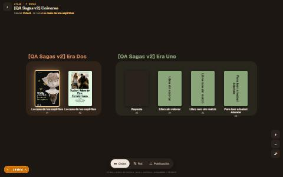
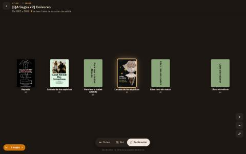
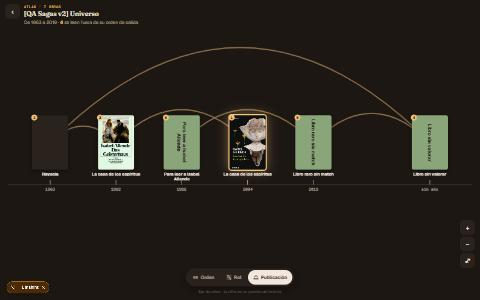
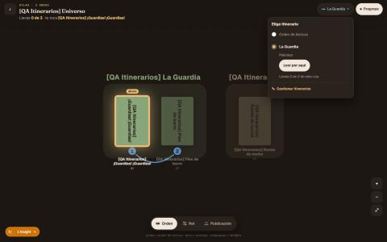
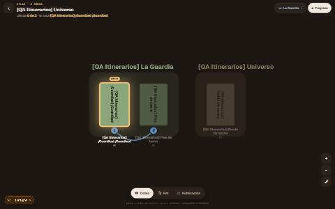
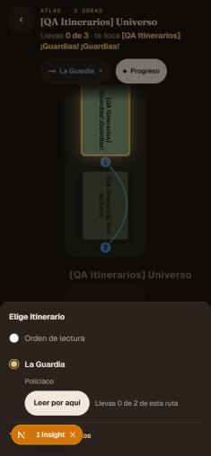
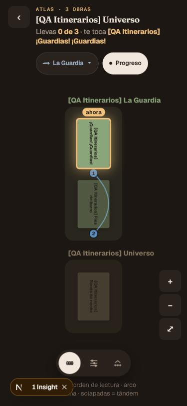

# Atlas de la saga: evidencia

> **[Evidencia local · 2026-10-28]** Rama `claude/sagas-atlas-a6e350`, PR pendiente (cerrará #1541).
> Diseño en [la spec](../superpowers/specs/2026-10-28-sagas-atlas-design.md); decisiones en
> [`decisiones.md`](../requirements/decisiones.md) (entrada «Atlas de la saga», 2026-10-28). Sin migraciones ni
> cambios de esquema. Producción no verificada.

## Qué se entrega

`/saga/[id]/mapa` pasa a ser el atlas de la saga: plano DOM + SVG con la cámara pura compartida con Entre
nosotros, lentes Orden · Rol · Publicación, capas Itinerario y Progreso, mini-ficha, hoja de itinerarios, lista
accesible («Ver como lista») e interruptor de opcionales. Sustituye al grafo (React Flow) y a `/como-leerla`
(ahora una redirección). `@xyflow/react` sale de `package.json` y del lock.

## Comprobaciones

Node 22 (fnm).

| Comando | Resultado |
|---|---|
| `npx vitest run` (suite completa) | 6250+ de 6253 en verde. **3 fallos preexistentes**: tests que escanean el disco y mueren por timeout con la suite entera; pasan cada uno solo. |
| `npx tsc --noEmit` | limpio |
| `npm run lint` | 0 errores (avisos preexistentes ajenos) |
| `npm run build` | OK |

## e2e contra build de producción

`next start` en el puerto 3000, `--retries=0`, 13 specs:

| Spec | Resultado |
|---|---|
| `sagas-timeline-estados` | 3/3 |
| `sagas-opcionales-saltables` | 4/4 |
| `sagas-atlas` (nueva) | 11/11 |
| `sagas-ficha-lector` | 14/14 |
| `sagas-grafo-estados` | 4/4 |
| `sagas-v2-mapa` | 4/4 |
| `sagas-roles` | 4/4 |
| `sagas-tandem-opcional` | 2/2 |
| `sagas-mapa-derivado` | 3/3 |
| `sagas-ventana-motivo-track` | 3/3 |
| `sagas-tandem-metadatos` | 3/3 |
| `sagas-itinerarios` | 5/5 |
| `sagas-orden-designado` | 2/2 |

Varias de estas specs dependían de «Cómo leerla» o del grafo y se mudaron al atlas. La e2e `sagas-orden-designado` reintenta el clic de «Usar como orden de lectura» por una carrera previa a la hidratación (ver «Pendiente»).

### Segunda tanda, tras la revisión final de rama

Build nuevo con los arreglos de la revisión final (`69e28556`), `next start`, `--retries=0`. Son las specs que leen la balda de la ficha, afectada por el cambio de `deriveTimeline`, más el atlas y la ficha otra vez:

| Spec | Resultado |
|---|---|
| `sagas-v2`, `sagas-v2-biblioteca`, `sagas-v2-curacion` | 8/8 |
| `sagas-rol-narrativo`, `sagas-colocacion-bloques` | todo verde |
| `sagas-colocacion-opcionalidad` | 2 fallos ya conocidos: #1543 (los CHECK de BD responden 409 y el test espera 400) |
| `sagas-ventanas`, `sagas-ventana-anidada` | todo verde |
| `sagas-editor-secuencia` | 2 fallos ya conocidos: #1544 (zonas y borrador desfasados; esta rama no toca el editor) |
| `sagas-atlas`, `sagas-ficha-lector` | 25/25 |

## Puntos de control visuales

Visto bueno del usuario en los dos:

1. Lente Orden (escritorio y móvil).
2. Capas e itinerarios (Itinerario, Progreso, hoja).

Capturas (JPG, datos del universo QA de dev):

| Captura | Qué enseña |
|---|---|
|  | Lente Orden, escritorio |
|  | Lente Orden, móvil |
|  | Nivel de islas, móvil |
|  | Lente Publicación, escritorio |
|  | Publicación con hilo y años |
|  | Mini-ficha de una obra |
|  | Capa Itinerario |
|  | Hoja inferior, móvil |
|  | Itinerario, móvil |

## Decisiones de implementación con efecto fuera del atlas

- `deriveTimeline` ya no descarta obras sin hueco ni conexión (pasan a filas puente al final). Lo encontró la e2e
  de itinerarios: la «Trilogía» miembro directa sin `position` no salía en el atlas. Efecto lateral bueno: la
  balda de la ficha también la enseña y una saga sin posiciones deja de mostrar el estado vacío.
- Redirecciones legadas como redirect de cliente en streaming (HTTP 200).

## Qué no se ha verificado

- Un dispositivo Android real con Capacitor (pellizco, doble toque, rendimiento).
- Doble toque para acercar en táctil real (en navegador solo se emula).
- Rendimiento con el Cosmere en producción (~50 obras con portada).
- Los umbrales del zoom semántico con sagas reales de producción.

## Pendiente

Issues abiertas con lo que quedó fuera:

- #1560 «Usar como orden de lectura» pierde el clic antes de hidratar (`/rutas`) — `tipo:bug`, P2.
- #1561 Umbrales del zoom semántico y encuadre inicial con datos de producción — `tipo:deuda`, P3.
- #1562 Gestos y rendimiento en Android real con Capacitor — `tipo:cobertura`, P2.
- #1563 Pulido de accesibilidad del atlas — `tipo:deuda`, P3.
- #1564 Atrás/Adelante no resincroniza lente y rol — `tipo:deuda`, P3.
- #1565 La hoja de itinerarios solo enseña el resumen de la ruta activa — `tipo:deuda`, P3.

#1541 se cierra con la PR (`Closes #1541`).
