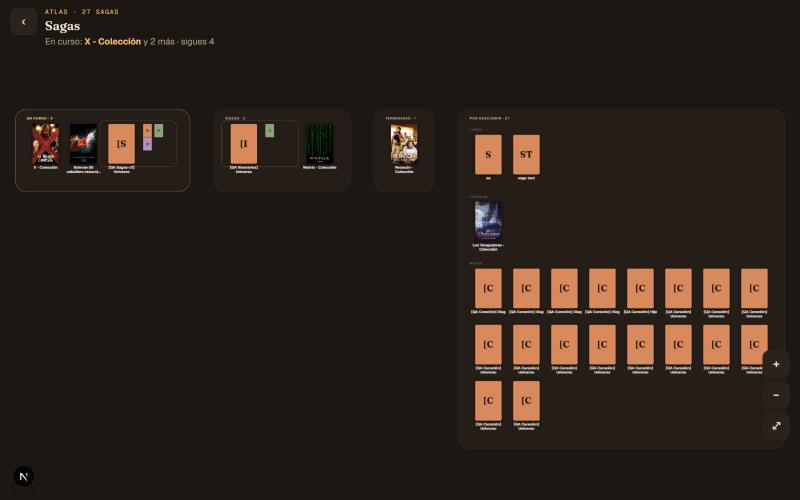
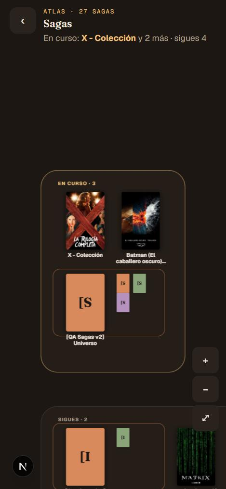
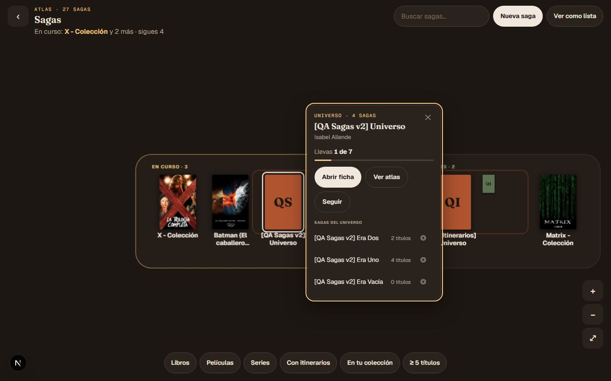
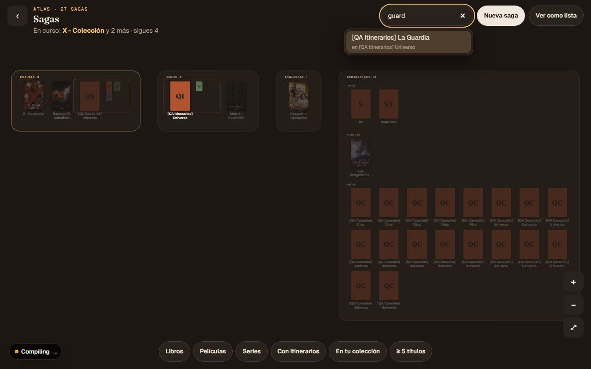
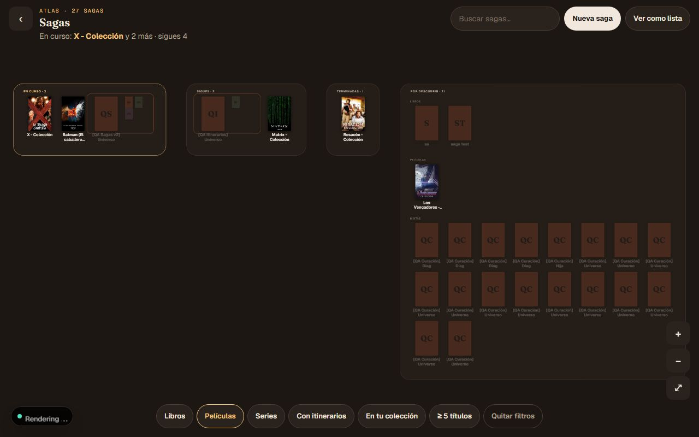
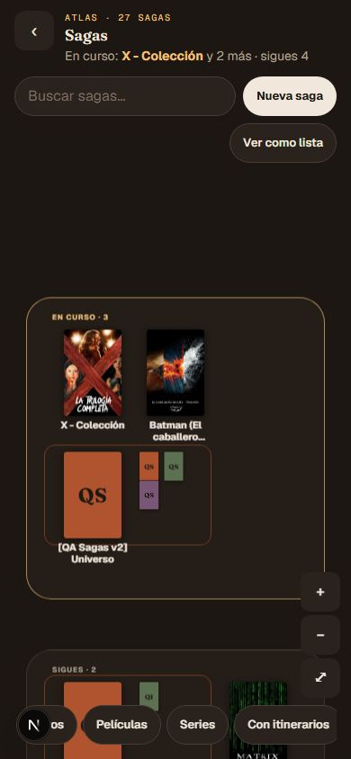
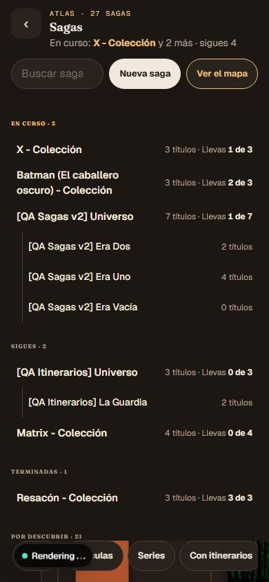

# Atlas de sagas y universos: evidencia

> **[Evidencia local · 2026-10-28]** Rama `claude/sagas-indice-atlas`, PR pendiente.
> Diseño en [la spec](../superpowers/specs/2026-10-28-sagas-indice-atlas-design.md); decisiones en
> [`decisiones.md`](../requirements/decisiones.md) (entrada «Atlas de sagas y universos», 2026-10-28). Sin
> migraciones ni cambios de esquema. Sin `use cache` nuevo (regla #437). Producción no verificada.

## Qué se entrega

`/sagas` pasa de rejilla de tarjetas a un atlas a pantalla completa: plano DOM + SVG con la cámara compartida,
cuatro territorios según tu relación con cada saga (En curso · Sigues · Terminadas · Por descubrir; por tipo de
obra sin sesión), islas de universo, mini-ficha (hoja inferior en móvil), buscador, filtros que atenúan y
«Ver como lista». La cámara, su almacenamiento y las hojas pasan a `src/lib/atlas` y `src/components/atlas`.

## Comprobaciones

Node 22 (fnm).

| Comando | Resultado |
|---|---|
| `npx vitest run` sobre `src/lib/sagas`, `src/components/sagas`, `src/components/saga`, `src/app` | verde (1240+ pruebas) |
| `npx tsc --noEmit` | limpio |
| `npm run lint` | 0 errores |
| `npm run build` | OK, sin aviso «uncached data» |

## e2e contra build de producción

`next start` en el puerto 3000, `--retries=0`:

| Spec | Resultado |
|---|---|
| `sagas-indice-atlas` (nueva) | 11/11 |
| `ia-navegacion` | 11/11 |
| `sagas-v2-curacion`, «multi-chip y hacer principal» | verde |
| `sagas-v2-curacion`, «crear saga, editar su ficha y anidar» | **rojo**: en `/saga/<id>/editar`, `input[name="name"]` resuelve a 2 elementos (patrón de #1494). Falla antes de llegar a `/sagas` y es ajeno a esta rama: #1574 |

`sagas-indice-atlas` cubre mini-ficha y ficha (escritorio y móvil 390x844 con hoja inferior), lista y teclado
(ambos formatos), cada saga en su zona con sesión, zonas por tipo sin sesión, buscar y volar, que el buscador no
pierde lo escrito al teclear (valor, foco y `?q=`), seguir mueve a Sigues, el filtro por tipo atenúa y el enlace
viejo `?vista=sigo`.

## Puntos de control visuales

Visto bueno del usuario en los dos:

1. Zonas y zoom, tras dos retoques: iniciales solo con letras y, en vertical, todas las zonas con el ancho de 3
   columnas.
2. Mini-ficha, buscador, filtros y lista.

Capturas (JPG, datos del universo QA de dev):

| Captura | Qué enseña |
|---|---|
|  | Territorios, escritorio |
|  | Territorios, móvil |
|  | Mini-ficha de una saga |
|  | Buscador con coincidencias |
|  | Filtros que atenúan |
|  | Plano, móvil |
|  | Hoja inferior, móvil |
|  | «Ver como lista», móvil |

## Qué no se ha verificado

- Un Android real con Capacitor (pellizco, arrastre, doble toque, teclado virtual, rendimiento).
- Rendimiento con el catálogo de producción (120 sagas, 107 raíces, portadas reales).
- Los umbrales del zoom semántico con datos de producción.
- Producción: nada se ha desplegado.

## Pendiente

Issues abiertas con lo que quedó fuera o se descubrió:

- #1573 `followSaga`/`unfollowSaga` ignoran el error de Supabase; la vuelta atrás optimista nunca salta — `tipo:bug`, P2.
- #1574 e2e `sagas-v2-curacion` «crear saga, editar su ficha y anidar» falla por `input[name="name"]` duplicado — `tipo:cobertura`, P2.
- #1575 A nivel de zonas (`k < 0.5`) las portadas salen del orden de tabulación — `tipo:deuda`, P3.
- #1576 Credenciales del colaborador de pruebas como literal de respaldo en 5 specs — `tipo:deuda`, P3 (`area:infra`).
- #1577 Gestos y rendimiento en Android real con Capacitor — `tipo:cobertura`, P2 (relacionada con #1562, del atlas de la saga).
