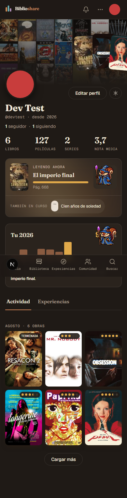

# Perfil visual: evidencia

> **[Evidencia local · 2026-11-01]** Rama `claude/perfil-visual`, PR pendiente (cerrará #1580). Diseño en
> [la spec](../superpowers/specs/2026-10-29-perfil-visual-design.md); decisiones en
> [`decisiones.md`](../requirements/decisiones.md) (entrada «Perfil visual», 2026-11-01). Sin migraciones ni
> cambios de esquema; sin `use cache` nuevo (regla #437). Producción no verificada.

## Qué se entrega

`/u/[username]` con cabecera en capas (mosaico de terminadas y abanico de Destacados), identidad, cifras
grandes, «Leyendo ahora» con la mascota compacta, «Su año» y la actividad como muro mixto por mes. Se retiran
`profile-header.tsx`, `profile-activity-feed.tsx` y `profile-feed-buckets.ts`.

## Rango de commits

`git log --oneline 2de66237..HEAD` (antes de este commit de documentación): 17 commits, de `3155acaa`
(tipo de portada del perfil) a `9c73f98e` (las ausencias del e2e esperan al streaming).

## Comprobaciones

Node 22 (fnm).

| Comando | Resultado |
|---|---|
| `npx vitest run src/lib/profile src/components/profile src/components/pet "src/app/u/[username]" src/lib/social` | 73 ficheros, 635 tests, todos en verde |
| `npx tsc --noEmit -p .` | limpio |
| `npm run lint` | 0 errores, 30 avisos (`no-unused-vars` en tests ajenos, preexistentes) |

## e2e contra build de producción

`npx next build --webpack` (Turbopack falla con el junction de `node_modules` del worktree) +
`npx next start -p 3000`, `--retries=0`.

| Spec | Resultado |
|---|---|
| `perfil-visual` (nueva) | 5/5 |
| `go-perfil`, `avatar-upload`, `a11y-landmark-main` | verdes |
| `avisos-por-persona` | falló una vez y pasó al repetirla aislada (flaky de entorno) |
| `feed-tarjetas-por-tipo` (3 casos) | rojos: es #1413, falla también en `main`; van a `/`, no a `/u/` |

Total de la tanda de regresión: 8 verdes y 4 rojos (los tres de #1413 y el flaky de arriba, que luego pasó).
La cuenta de pruebas `devtest` es admin y lee perfiles privados, así que los casos de privado y de seguidor
usan visores temporales sin rol (se borran al acabar). El helper `waitForProfileSettled` espera al streaming
antes de afirmar ausencias.

## Puntos de control visuales

Ambos aprobados por el usuario el 2026-11-01:

1. **Cabecera y bloques** (identidad, cifras, Leyendo ahora, Su año, layout de escritorio).
2. **El muro** mixto por mes.

Corrección pedida por el usuario tras el primer punto: la mascota aparecía recortada en «Leyendo ahora»
(`796464fd`); después se fijó a escala entera 1 con ventana de 72 px (`d1e01344`).

## Capturas

Cuenta de pruebas `devtest`, `next dev` local, página completa. La barra de navegación inferior se ve
superpuesta en móvil porque es fija.

| | Oscuro | Claro |
|---|---|---|
| 1280 px | [perfil-1280-dark.png](assets/perfil-visual/perfil-1280-dark.png) | [perfil-1280-light.png](assets/perfil-visual/perfil-1280-light.png) |
| 390 px | [perfil-390-dark.png](assets/perfil-visual/perfil-390-dark.png) | [perfil-390-light.png](assets/perfil-visual/perfil-390-light.png) |

## Pendiente

- PR contra `main` (cerrará #1580 y, si el layout lo resuelve, #431).
- `feed-tarjetas-por-tipo` sigue rojo por #1413, ajeno a esta rama.
